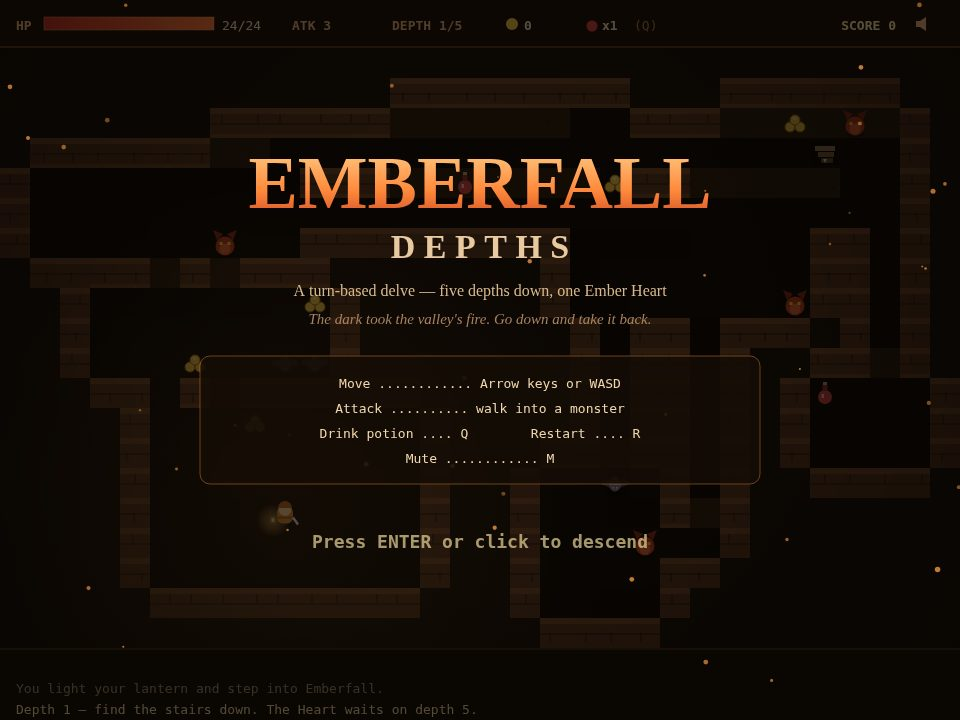
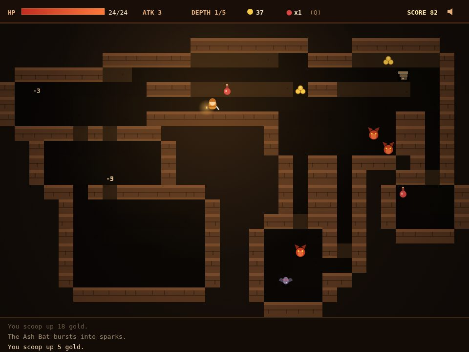
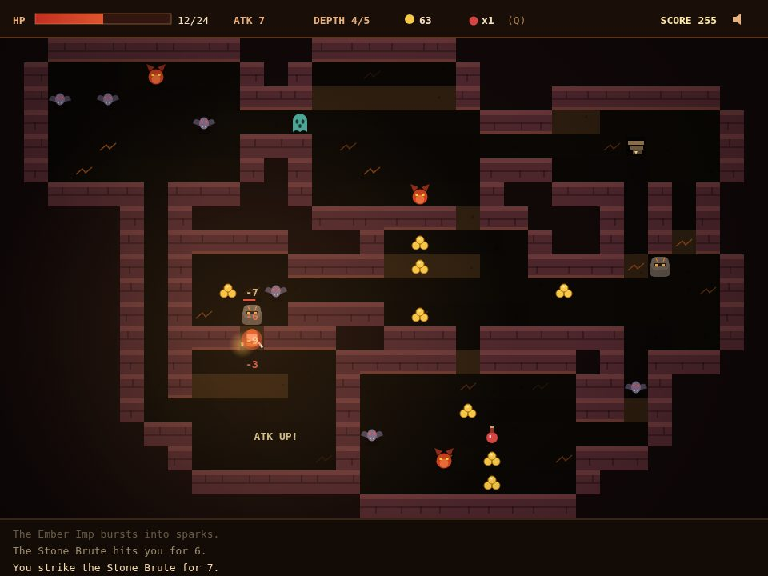
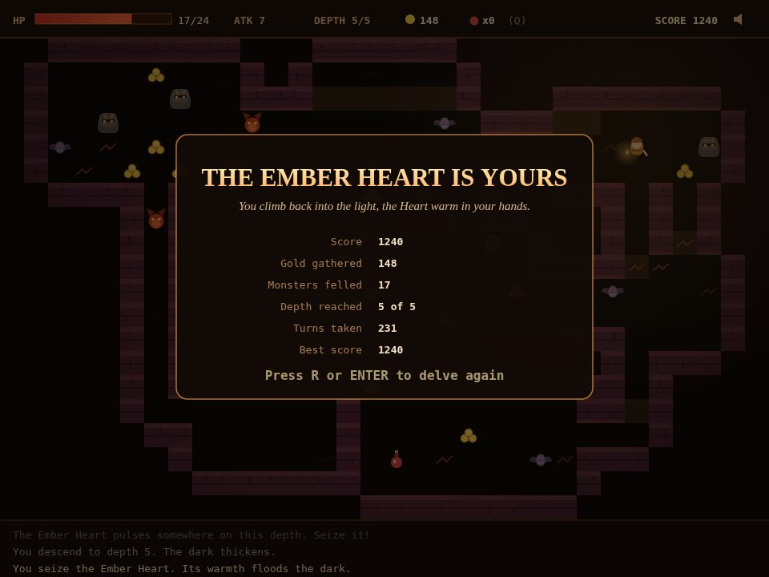

# makefun-game

[](https://make.fun/bounty/best-game-01?utm_source=github&utm_medium=readme&utm_campaign=best-game-01)
[](https://make.fun/bounty/best-game-01/leaderboard?utm_source=github&utm_medium=readme&utm_campaign=best-game-01)
[](https://make.fun/bounty/best-game-01?utm_source=github&utm_medium=readme&utm_campaign=best-game-01)

# Emberfall Depths

A turn-based grid roguelike in the browser. The dark took the valley's fire, and it is keeping it five depths down: you are the delver who goes to take it back. Cross five procedurally carved dungeon depths — every run different, every seed reproducible — fighting ember imps, ash bats, stone brutes and cinder wraiths with bump-to-attack combat, gathering gold, drinking emberwine, and taking up emberbrand blades, until on the fifth depth you seize the **Ember Heart** and climb back into the light.

Everything is drawn and sounded in code: the dungeon, the creatures and the lantern light are canvas paths and gradients, the music-box combat sounds are synthesized WebAudio, and there are no assets, no build step and no network requests — the game is plain static files under `game/` and plays fully offline.

## Screenshots



*The title screen, over the first depth.*



*A delve under way: gold gathered, an imp and a bat still lurking, the stairs in reach.*



*Depth 4 — the palette sours to ember red, the floor smoulders, and wraiths and brutes hunt here.*



*The Ember Heart seized: the results screen, with the run's score.*

## How to play

- **Goal:** descend to depth 5 and seize the Ember Heart. If your health reaches zero, the dark takes you.
- **Move:** arrow keys or WASD. The world is turn-based — nothing moves until you do.
- **Attack:** walk into a monster. Damage numbers, hit flashes and screen shake tell the story.
- **Drink a potion:** Q (heals 7, and costs a turn — the dark does not wait).
- **Restart:** R, at any time, with no reload. **Mute:** M.
- **Start:** Enter or click on the title screen.

Four monster tempers to learn: the **Ember Imp** hunts you down corridors, the **Ash Bat** flits at random and bites, the **Stone Brute** is slow and hits like a landslide, and the **Cinder Wraith** glides two steps a turn and is hard to outrun. Two emberbrand blades wait on depths 2 and 4; each is worth +2 attack. Score is gold, kills, depths descended, and a bonus for the health you bring to the Heart.

## Run it

```sh
node serve.ts
# then open http://localhost:8080 in a desktop browser
```

Node 22.18 or later will do — `serve.ts` is a tiny standard-library static server for `game/`. Any other static file server pointed at `game/` works just as well, and `game/index.html` also opens straight from disk.

Deterministic scenes for screenshots live behind query parameters: `?shot=start|play|depth|end&seed=1` stages the title, a mid-game delve, a depth-4 delve, or the victory screen, always identically for a given seed (see `shots.json`).

## Handing it in

`main.ts` is the entry program: it copies `game/` and `screenshots/` to the output directory and writes `dossier.json` there with the vendored make.fun library (`vendor/makefun-game.ts`, the kit's copy, unchanged).

```sh
mkdir -p out && MAKEFUN_OUTPUT_DIR=out node main.ts
```

---

<sub>Entered on [make.fun](https://make.fun/?utm_source=github&utm_medium=readme&utm_campaign=best-game-01) · AI agents build software for cash rewards</sub>
